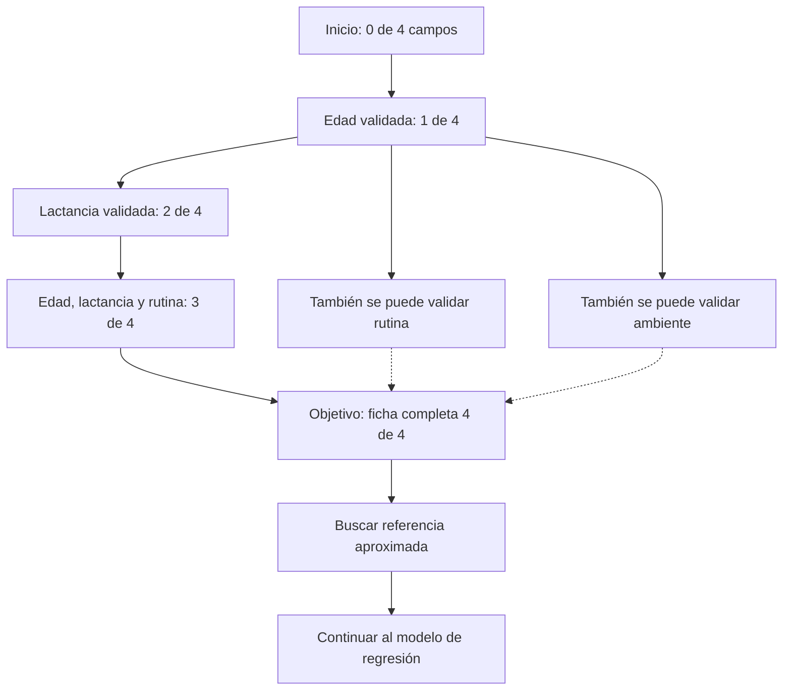

# 02 · Espacio de estados del problema

**Caso:** Sueño en los recién nacidos · **Actividad:** Representación formal del problema (5 puntos)

## 1. Idea del modelo conceptual

Antes de calcular una estimación, una aplicación debe disponer de una ficha completa y válida. Voy a tratar cada **estado** como el conjunto de campos que la aplicación ya ha registrado y verificado. La búsqueda debe encontrar una secuencia de acciones para completar los cuatro campos sin saltarse las validaciones.

Esta parte representa **el proceso de preparación de la ficha**, no estados fisiológicos de un bebé. Por eso el objetivo de la búsqueda es técnico y verificable.

## 2. Representación formal

- **Campos obligatorios:** `edad_meses`, `lactancia`, `rutina`, `ambiente`.
- **Estado:** `S ⊆ {edad_meses, lactancia, rutina, ambiente}`. Un elemento pertenece a `S` cuando está capturado y es válido.
- **Estado inicial:** `S0 = ∅` (ningún campo confirmado).
- **Estado objetivo:** `SG = {edad_meses, lactancia, rutina, ambiente}` (los cuatro confirmados).
- **Operador:** `agregar(campo)`, que incorpora un campo ausente si su valor supera la validación.
- **Costo:** `1` por campo registrado. Se desea llegar a la ficha completa sin pasos innecesarios.

### Restricciones

1. La edad debe ser numérica y estar entre **3 y 12 meses**; es el rango del ejemplo, no un límite clínico.
2. `lactancia` solo toma las categorías `materna`, `mixta` o `fórmula`.
3. `rutina` solo toma los valores `constante` o `variable`.
4. `ambiente` solo toma los valores `tranquilo` o `ruidoso`.
5. No se agrega un campo dos veces.
6. Se registra la **edad antes de las demás variables** para validar primero el intervalo de la demostración.

## 3. Representación visual de la búsqueda

El siguiente diagrama muestra un ejemplo de ruta. Después de registrar la edad, los otros campos se pueden incorporar en distintos órdenes. La búsqueda no está obligada a seguir exactamente esta secuencia.

**Lectura:** la primera operación válida es registrar la edad. Luego existe más de un camino hacia la meta, aunque todos requieren completar los mismos cuatro campos.

## 4. Ejemplo concreto de transiciones

Ficha de prueba: `edad_meses=8`, `lactancia=mixta`, `rutina=constante`, `ambiente=tranquilo`.

| Paso | Estado verificado | Acción | Restricción que se comprueba |
|---:|---|---|---|
| 0 | `{}` | Inicio | Aún no hay información |
| 1 | `{edad_meses}` | Registrar edad = 8 | `3 ≤ edad ≤ 12` |
| 2 | `{edad_meses, lactancia}` | Registrar lactancia = mixta | Valor en categorías permitidas |
| 3 | `{edad_meses, lactancia, rutina}` | Registrar rutina = constante | Valor permitido |
| 4 | `{edad_meses, lactancia, rutina, ambiente}` | Registrar ambiente = tranquilo | Ficha completa y válida |

**Ejemplo de rechazo:** si la edad es `-2`, o la lactancia se escribe con una categoría inexistente, la operación no se ejecuta y la ficha no alcanza el estado objetivo.

## 5. Exploración y búsqueda

Uso **búsqueda en anchura (BFS)** porque cada acción cuesta lo mismo. BFS permite encontrar una ruta con el menor número de operaciones. El algoritmo:

1. Comienza con el estado vacío.
2. Genera los estados vecinos aplicando solo operaciones permitidas.
3. Agrega los estados nuevos a una cola.
4. Repite hasta encontrar el estado con los cuatro campos.
5. Reconstruye la ruta a partir de sus predecesores.

El notebook muestra los nodos explorados y la ruta seleccionada. Después busca, entre las referencias de edad **3, 6 y 12 meses**, cuál está más cerca de una consulta; esto es solo una comparación de ejemplos aproximados, **no es la predicción del modelo ML**.

## 6. Relación con Machine Learning

El espacio de estados responde: «¿están listos los datos para usarlos?». La regresión responde otra pregunta: «¿qué valor numérico genera el modelo para esa ficha?». Los notebooks están separados para poder explicar ambas etapas sin mezclarlas.

> **Límite del prototipo:** las categorías de lactancia, rutina y ambiente se incorporan para practicar variables de entrada. No se demuestra ningún efecto real de esas características sobre el sueño infantil.
